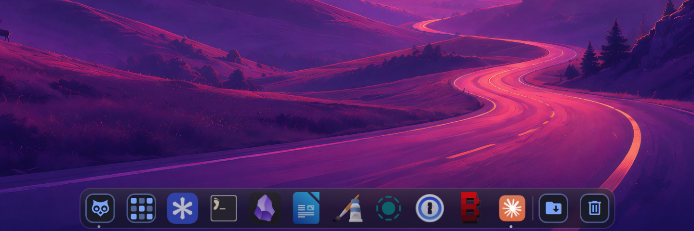
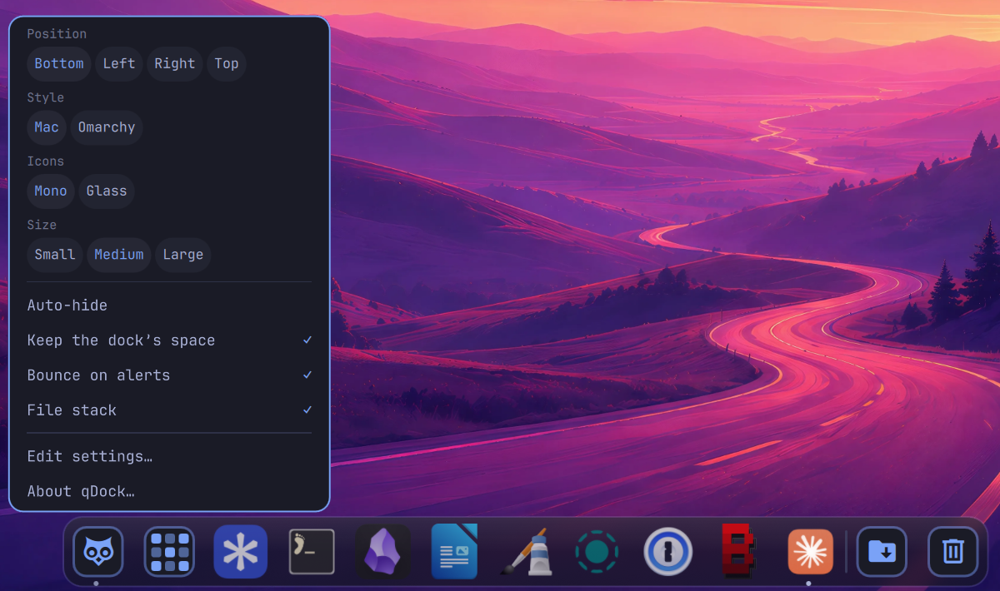
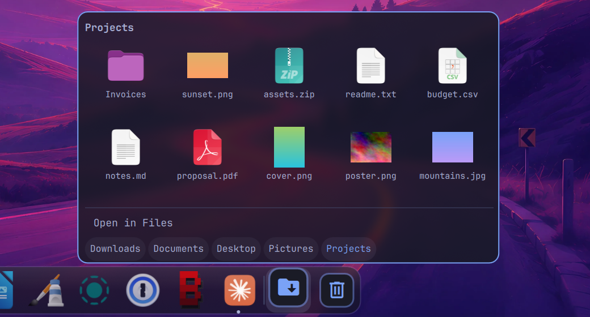
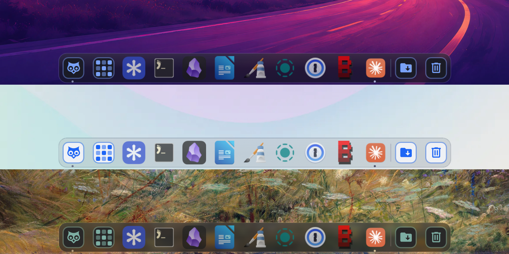

<p align="center">
  
</p>

<h1 align="center">qDock</h1>

<p align="center">Un dock façon Mac pour <a href="https://omarchy.org">Omarchy</a>, aux couleurs de votre thème.</p>

<p align="center"><a href="README.md">English version</a></p>



**Vous venez de macOS ?** qDock, c'est le Dock : le Finder en tête, le Launchpad, les piles et la Corbeille.
Ajoutez [qExposé](https://github.com/quebecstudio-mods/omarchy-qexpose) pour Exposé et Mission Control, et [qCenter](https://github.com/quebecstudio-mods/omarchy-qcenter) pour le
centre de notifications.

qDock remplace le dock d'Omarchy sur les bureaux flottants. Il garde ce que fait
le dock d'origine (apps épinglées, fenêtres ouvertes, masquage automatique,
grille d'apps, son Launchpad) et ajoute :

- **Fichiers, en hibou**, à la place du Finder sur Mac. Un clic ouvre votre gestionnaire de fichiers ; un clic
  droit liste vos dossiers, vos favoris et la corbeille.
- **La liste des fenêtres.** Clic droit sur une app pour voir ses fenêtres, en
  ramener une, en ouvrir une nouvelle ou quitter.
- **Une pile**, comme celle des Téléchargements sur Mac, de vos derniers téléchargements (ou d'un autre dossier), avec des
  fichiers à ouvrir, afficher, copier ou glisser dans une autre app.
- **Une corbeille**, au bout comme sur Mac, qui montre quand elle est pleine, accepte les fichiers
  qu'on y dépose et se vide depuis son menu.
- **Pastilles, rebonds et groupes.** Les apps qui demandent l'attention
  rebondissent, puis s'illuminent ; les apps web peuvent afficher un nombre de
  non-lus ; les apps peuvent être groupées par couleur.
- **Deux styles.** Mac (verre givré, coins arrondis) ou Omarchy (opaque, avec
  les coins et les bordures de votre thème).
- **Des icônes qui tiennent.** Trois tailles, et les icônes rapetissent quand
  beaucoup d'apps sont ouvertes.
- **Garde sa place**, si vous le voulez : les fenêtres agrandies s'arrêtent au
  dock.
- **Français et anglais**, selon la langue d'Omarchy.

| Menu des réglages | Pile | Style Omarchy |
| --- | --- | --- |
|  |  |  |

Il suit votre thème quand vous en changez : ici avec Tokyo Night, Catppuccin
Latte et Gruvbox.



## Installation

```bash
omarchy plugin add https://github.com/quebecstudio-mods/omarchy-qdock --enable
```

Omarchy affiche d'abord un avertissement de sécurité et demande de confirmer
(*Clone and add this plugin?*) ; ajoutez `--yes` pour sauter la question dans un
script.

Le dock ne s'affiche que sur les bureaux **flottants**, comme celui d'Omarchy.
Un Omarchy tout neuf est en mosaïque : rien n'apparaît tant que vous n'avez pas
rendu un bureau flottant avec `omarchy hyprland workspace layout toggle`, ou fait
de ce mode le défaut avec `omarchy hyprland workspace layout default floating`.

qDock prend la place du dock d'Omarchy : l'activer désactive celui d'origine, et
le désactiver le remet.

Rien à désinstaller avant. Un autre dock, par contre, s'afficherait à côté de
qDock : désactivez tout autre plugin Omarchy qui remplace le dock (`omarchy plugin
disable <id>`) et tout dock autonome que vous lancez vous-même, comme
`nwg-dock-hyprland`.

### Verre givré

Le style Mac est translucide. Pour le flou derrière lui, ajoutez cette règle à
`~/.config/hypr/hyprland.lua` :

```lua
hl.layer_rule({ match = { namespace = "^(omarchy-dock|omarchy-dock-apps)$" }, blur = true, ignore_alpha = 0.2 })
```

## Utilisation

| | Clic | Clic droit |
| --- | --- | --- |
| **Hibou** | Ses fenêtres, ou votre dossier personnel | Dossiers, favoris, corbeille, nouvelle fenêtre |
| **Bouton Apps** | Grille de toutes les apps | Les réglages du dock |
| **App** | L'ouvrir, ou la ramener | Ses fenêtres, nouvelle fenêtre, garder dans le dock ou l'en retirer, quitter |
| **Pile** | Les derniers fichiers du dossier | Pareil |
| **Corbeille** | L'ouvrir (ou la ramener) | Vider la corbeille |

Glissez les apps pour les réordonner, ou depuis la grille vers le dock pour les
épingler. Un clic du milieu sur une app ouvre une nouvelle fenêtre ; sur la
pile, il ouvre son dossier.

## Réglages

Les plus courants sont dans le menu du dock : clic droit sur le bouton Apps. Les
autres vont dans l'entrée de qDock, sous `plugins`, dans
`~/.config/omarchy/shell.json` (**Modifier les réglages…** dans le menu l'ouvre) :

```json
{
  "id": "quebecstudio.qdock",
  "style": "omarchy",
  "iconSize": "large",
  "stackFolders": ["~/Pictures/Screenshots"],
  "groups": [{ "name": "travail", "color": "#2dd4bf", "match": ["^chrome-.*-Profile_1$"] }]
}
```

| Réglage | Valeurs | Par défaut |
| --- | --- | --- |
| `style` | `"mac"`, `"omarchy"` | `"mac"` |
| `iconStyle` | `"mono"` (Fichiers, pile et corbeille dessinés à la couleur d'accent du thème), `"glass"` | `"mono"` |
| `iconSize` | `"small"`, `"medium"`, `"large"`, ou un nombre de pixels (de 24 à 96) | `"medium"` |
| `bounce` | Les apps qui demandent l'attention rebondissent | `true` |
| `reserveSpace` | Les fenêtres agrandies s'arrêtent au dock | `false` |
| `stack` | Afficher la pile | `true` |
| `stackCount` | Fichiers dans la pile, de 5 à 30 | `15` |
| `stackFolders` | Dossiers proposés en plus de Téléchargements, Documents, Bureau et Images | `[]` |
| `filesApp` | Identifiant du gestionnaire de fichiers | `"org.gnome.Nautilus"` |
| `filesIcon` | `"mono"`, `"glass"`, `"theme"`, ou le chemin d'une image (absolu ou commençant par `~/`) | `iconStyle` |
| `groups` | Groupes de couleur, dans l'ordre : `name`, `color`, et `match`, des regex sur l'identifiant de l'app (la classe de fenêtre pour une app qui n'en a pas) | `[]` |
| `badges` | Nombres de non-lus des apps web (voir plus bas) | — |

La position, le masquage automatique et les apps épinglées restent dans les
réglages `dock` d'Omarchy, qu'on change avec `omarchy dock`.

### Pastilles

Une pastille affiche sur l'icône d'une app un nombre lu dans un fichier JSON, et
suit le fichier quand il change. Chaque entrée donne les apps (`match`, des regex
sur l'identifiant de l'app, ou la classe de fenêtre pour une app qui n'en a pas), le fichier et le chemin (`path`)
vers le nombre : un `/` par niveau, et un segment `clé=valeur` choisit un élément
d'une liste.

```json
"badges": [{ "match": ["^Mail$"], "file": "~/.local/state/mail.json", "path": "accounts/name=work/unread" }]
```

## Avec qExposé

[qExposé](https://github.com/quebecstudio-mods/omarchy-qexpose) ajoute un Exposé
façon Mac et un sélecteur Alt+Tab avec aperçus. Quand il est activé, le menu
d'une app dans le dock propose **Afficher toutes les fenêtres** : toutes les
fenêtres de cette app, tous bureaux confondus, réduites comprises.

## Commandes

qDock répond aux mêmes commandes que le dock d'Omarchy, et à quelques autres :

```bash
omarchy-shell -q omarchy.dock apps       # ouvrir ou fermer la grille d'apps
omarchy-shell -q omarchy.dock stack      # ouvrir ou fermer la pile, sur l'écran actif
omarchy-shell -q omarchy.dock settings   # ouvrir ou fermer le menu des réglages, sur l'écran actif
omarchy-shell -q omarchy.dock stackOn DP-1      # pareil, sur un écran nommé
omarchy-shell -q omarchy.dock settingsOn DP-1
```

## Licence

MIT © Québec Studio

macOS, Finder, Launchpad, Mission Control et Exposé sont des marques d'Apple Inc. Ce projet n'est ni affilié à Apple ni approuvé par Apple.
