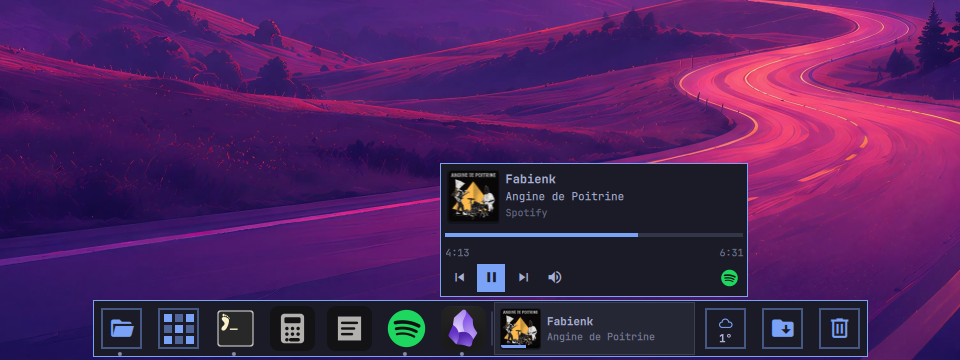
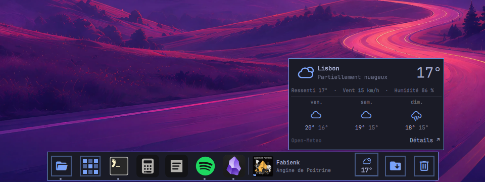
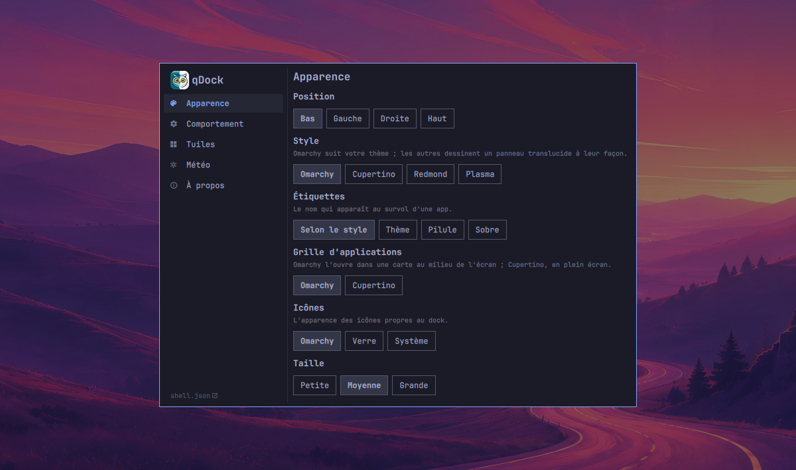
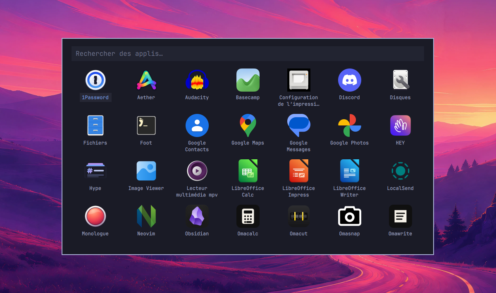
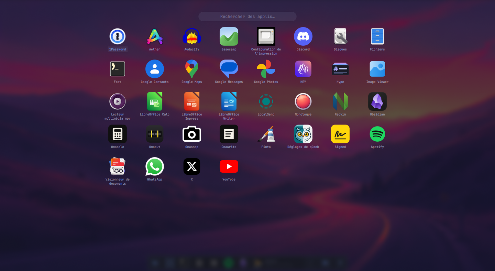

<p align="center">
  
</p>

<h1 align="center">qDock</h1>

<p align="center">Un dock façon Mac pour <a href="https://omarchy.org">Omarchy</a>, aux couleurs de votre thème.</p>

<p align="center"><a href="README.md">English version</a></p>


**Vous venez de macOS ?** qDock, c'est le Dock : le Finder en tête, le Launchpad, les piles et la Corbeille.
Ajoutez [qExposé](https://github.com/quebecstudio-mods/omarchy-qexpose) pour Exposé et Mission Control, et [qCenter](https://github.com/quebecstudio-mods/omarchy-qcenter) pour le
centre de notifications.

qDock remplace le dock d'Omarchy sur les bureaux flottants. Il garde ce que fait
le dock d'origine (apps épinglées, fenêtres ouvertes, masquage automatique,
grille d'apps, son Launchpad) et ajoute :

- **Fichiers, en dossier ouvert**, à la place du Finder sur Mac. Un clic ouvre votre gestionnaire de fichiers ; un clic
  droit liste vos dossiers, vos favoris et la corbeille.
- **La liste des fenêtres.** Clic droit sur une app pour voir ses fenêtres, en
  ramener une, en ouvrir une nouvelle ou quitter.
- **Une pile**, comme celle des Téléchargements sur Mac, de vos derniers téléchargements (ou d'un autre dossier), avec des
  fichiers à ouvrir, afficher, copier ou glisser dans une autre app.
- **Une corbeille**, au bout comme sur Mac, qui montre quand elle est pleine, accepte les fichiers
  qu'on y dépose et se vide depuis son menu.
- **La musique en cours**, si vous le voulez : une tuile avec la pochette, le titre et l'artiste de la
  musique qui joue (ou en pause) dans n'importe quel lecteur (Spotify, mpv, un navigateur ou une app
  web). Au survol, la progression et les commandes.
- **La météo**, si vous le voulez : le ciel et la température, et les trois prochains jours au
  survol. Elle s'ajoute au module météo de la barre d'Omarchy, sans le remplacer.
- **Pastilles, rebonds et groupes.** Les apps qui demandent l'attention
  rebondissent, clignotent ou s'illuminent ; les apps web peuvent afficher un nombre de
  non-lus ; les apps peuvent être groupées par couleur.
- **Quatre styles.** Omarchy (opaque, avec les coins et les bordures de votre
  thème), Cupertino (translucide et arrondi, comme sur Mac), Redmond (comme la
  barre des tâches de Windows) et Plasma (comme le gestionnaire de tâches de
  KDE). Chacun a ses indicateurs, son survol, ses pastilles, ses alertes et ses
  étiquettes ; alertes et étiquettes peuvent aussi se choisir à part.
- **Des icônes qui tiennent.** Fichiers, la pile, la corbeille et la météo aux
  couleurs du thème ou en verre, et Fichiers, la pile et la corbeille tirés de
  votre thème d'icônes si vous préférez ; trois tailles, et les icônes
  rapetissent quand beaucoup d'apps sont ouvertes.
- **Une fenêtre de réglages**, dessinée avec les contrôles d'Omarchy.
- **Garde sa place**, si vous le voulez : les fenêtres agrandies s'arrêtent au
  dock.
- **Français et anglais**, selon la langue d'Omarchy.

| Musique en cours | Météo |
| --- | --- |
|  |  |

| Fenêtre de réglages | Pile |
| --- | --- |
|  |  |

Les quatre styles : Omarchy, Cupertino, Redmond et Plasma.


Les trois styles d'icônes : Omarchy, verre et système.


| Grille d'apps, Omarchy | Grille d'apps, Cupertino |
| --- | --- |
|  |  |

Il suit votre thème quand vous en changez : ici avec Tokyo Night, Catppuccin
Latte et Gruvbox.


## Installation

```bash
omarchy plugin add https://github.com/quebecstudio-mods/omarchy-qdock --enable
```

Omarchy affiche d'abord un avertissement de sécurité et demande de confirmer
(*Clone and add this plugin?*) ; ajoutez `--yes` pour sauter la question dans un
script.

Le dock ne s'affiche que sur les bureaux **flottants**, comme celui d'Omarchy.
Un Omarchy tout neuf est en mosaïque : rien n'apparaît tant que vous n'avez pas
rendu un bureau flottant avec `omarchy hyprland workspace layout toggle`, ou fait
de ce mode le défaut avec `omarchy hyprland workspace layout default floating`.

qDock prend la place du dock d'Omarchy : l'activer désactive celui d'origine, et
le désactiver le remet.

Rien à désinstaller avant. Un autre dock, par contre, s'afficherait à côté de
qDock : désactivez tout autre plugin Omarchy qui remplace le dock (`omarchy plugin
disable <id>`) et tout dock autonome que vous lancez vous-même, comme
`nwg-dock-hyprland`.

### Flou derrière les styles translucides

Les styles Cupertino, Redmond et Plasma sont translucides (Cupertino le plus).
Pour le flou derrière eux, et derrière la grille d'apps en plein écran, ajoutez
cette règle à `~/.config/hypr/hyprland.lua` :

```lua
hl.layer_rule({ match = { namespace = "^(omarchy-dock|omarchy-dock-apps)$" }, blur = true, ignore_alpha = 0.2 })
```

## Utilisation

| | Clic | Clic droit |
| --- | --- | --- |
| **Fichiers** | Ses fenêtres, ou votre dossier personnel | Dossiers, favoris, corbeille, nouvelle fenêtre |
| **Bouton Apps** | Grille de toutes les apps | Les réglages du dock |
| **App** | L'ouvrir, ou la ramener | Ses fenêtres, nouvelle fenêtre, garder dans le dock ou l'en retirer, quitter |
| **Pile** | Les derniers fichiers du dossier | Pareil |
| **Corbeille** | L'ouvrir (ou la ramener) | Vider la corbeille |
| **Musique en cours** | Lecture ou pause | Garder les commandes ouvertes |
| **Météo** | Garder les détails ouverts (sans lieu, en choisir un) | Ses réglages |

Glissez les apps pour les réordonner, ou depuis la grille vers le dock pour les
épingler. Un clic du milieu sur une app ouvre une nouvelle fenêtre ; sur la
pile, il ouvre son dossier ; sur la musique, il ramène son lecteur.

La météo vient d'[Open-Meteo](https://open-meteo.com), sans compte ni clé,
toutes les 15 minutes ; tant que la tuile est désactivée, rien n'est demandé.
Sans lieu choisi dans qDock ni dans le panneau météo d'Omarchy, la tuile vous
propose d'en choisir un. **Détails** ouvre le panneau météo d'Omarchy s'il est
dans la barre et donne le même lieu, sinon une page de prévisions. Un clic du
milieu la met à jour.

Les commandes de la musique s'affichent au survol : précédente, lecture ou
pause, suivante, sourdine et le lecteur. La sourdine coupe le lecteur, pas tout
le système (pour une app web, tout son navigateur). Avec plusieurs lecteurs
ouverts, la tuile montre celui que pilotent les touches multimédias d'Omarchy,
celui qui joue depuis le plus longtemps, à moins que `musicPlayer` en désigne
un autre.

## Réglages

qDock a sa fenêtre de réglages : clic droit sur Fichiers ou sur le bouton Apps,
puis **Réglages du dock…**, ou **Réglages de qDock** dans le lanceur d'apps.
On y trouve l'apparence, le comportement, les tuiles, la météo, et À propos.

Pour l'avoir aussi dans le menu d'Omarchy, sous Apparence > Dock, ajoutez cette
ligne à `~/.config/omarchy/extensions/omarchy-menu.jsonc` :

```jsonc
"appearance.dock.qdock": {"icon":"󰒓","label":"Réglages de qDock","aliases":["qdock"],"action":"omarchy-shell -q quebecstudio.qdock settings"},
```

L'entrée du lanceur est dans le dossier `assets` du plugin :

```bash
cp ~/.config/omarchy/plugins/qdock/assets/qdock-settings.desktop ~/.local/share/applications/
cp ~/.config/omarchy/plugins/qdock/assets/logo.png ~/.local/share/icons/hicolor/256x256/apps/qdock.png
```

Tous les réglages sont gardés dans l'entrée de qDock, sous `plugins`, dans
`~/.config/omarchy/shell.json`. Les quelques-uns que la fenêtre laisse de côté
(groupes, pastilles, app Fichiers) s'y règlent à la main (le lien **shell.json**
au bas de la fenêtre l'ouvre) :

```json
{
  "id": "quebecstudio.qdock",
  "style": "cupertino",
  "iconSize": "large",
  "stackFolders": ["~/Pictures/Screenshots"],
  "groups": [{ "name": "travail", "color": "#2dd4bf", "match": ["^chrome-.*-Profile_1$"] }]
}
```

| Réglage | Valeurs | Par défaut |
| --- | --- | --- |
| `style` | `"omarchy"`, `"cupertino"` (`"mac"` en 1.0), `"redmond"`, `"plasma"` | `"omarchy"` |
| `launcher` | La grille d'applications : `"omarchy"` (une carte, comme celle du dock d'Omarchy), `"cupertino"` (plein écran) | `"omarchy"` |
| `iconStyle` | `"omarchy"` (Fichiers, pile, corbeille et météo dessinés à la couleur d'accent du thème ; `"mono"` avant la 1.1), `"glass"` (les icônes de qDock), `"system"` (celles de votre thème d'icônes, comme les apps) | `"omarchy"` |
| `iconSize` | `"small"`, `"medium"`, `"large"`, ou un nombre de pixels (de 24 à 96) | `"medium"` |
| `attention` | Comment une app qui demande l'attention le montre : `"auto"` (selon le style), `"bounce"` (rebond, puis halo), `"flash"` (clignote en orange, puis reste), `"highlight"` (case surlignée à l'accent) | `"auto"` |
| `labels` | Le nom affiché au survol d'une app : `"auto"` (selon le style), `"theme"` (l'infobulle de votre thème), `"pill"` (pilule), `"box"` (petite et sobre) | `"auto"` |
| `bounce` | Les alertes s'animent (rebond ou clignotement) avant de rester en évidence | `true` |
| `reserveSpace` | Les fenêtres agrandies s'arrêtent au dock | `false` |
| `stack` | Afficher la pile | `true` |
| `stackCount` | Fichiers dans la pile, de 5 à 30 | `15` |
| `stackFolders` | Dossiers proposés en plus de Téléchargements, Documents, Bureau et Images | `[]` |
| `music` | Musique en cours : `"hidden"`, `"mini"` (la pochette seule), `"normal"`, `"large"` (plus large, pour les longs titres) ; la pochette seule sur un dock latéral | `"hidden"` |
| `musicPlayer` | Le lecteur à montrer d'abord, par une partie de son nom, sans tenir compte de la casse (`"spotify"`) | `""` |
| `weather` | Afficher la tuile météo | `false` |
| `weatherLocation` | `{ "name", "latitude", "longitude", "country" }` (le code du pays règle l'unité en `"auto"`), choisi dans les réglages en cherchant une ville ; absent, le lieu du panneau météo d'Omarchy | — |
| `weatherUnit` | `"auto"` (l'unité du module météo d'Omarchy, sinon selon le pays du lieu), `"metric"`, `"imperial"` | `"auto"` |
| `filesApp` | Identifiant du gestionnaire de fichiers | `"org.gnome.Nautilus"` |
| `filesIcon` | `"omarchy"`, `"glass"`, `"system"`, ou le chemin d'une image (absolu ou commençant par `~/`) | `iconStyle` |
| `groups` | Groupes de couleur, dans l'ordre : `name`, `color`, et `match`, des regex sur l'identifiant de l'app (la classe de fenêtre pour une app qui n'en a pas) | `[]` |
| `badges` | Nombres de non-lus des apps web (voir plus bas) | — |

La position, le masquage automatique et les apps épinglées restent dans les
réglages `dock` d'Omarchy, qu'on change avec `omarchy dock`.

### Pastilles

Une pastille affiche sur l'icône d'une app un nombre lu dans un fichier JSON, et
suit le fichier quand il change. Chaque entrée donne les apps (`match`, des regex
sur l'identifiant de l'app, ou la classe de fenêtre pour une app qui n'en a pas), le fichier et le chemin (`path`)
vers le nombre : un `/` par niveau, et un segment `clé=valeur` choisit un élément
d'une liste.

```json
"badges": [{ "match": ["^Mail$"], "file": "~/.local/state/mail.json", "path": "accounts/name=work/unread" }]
```

## Avec qExposé

[qExposé](https://github.com/quebecstudio-mods/omarchy-qexpose) ajoute un Exposé
façon Mac et un sélecteur Alt+Tab avec aperçus. Quand il est activé, le menu
d'une app dans le dock propose **Afficher toutes les fenêtres** : toutes les
fenêtres de cette app, tous bureaux confondus, réduites comprises.

## Commandes

qDock a ses propres commandes :

```bash
omarchy-shell -q quebecstudio.qdock apps              # ouvrir ou fermer la grille d'apps
omarchy-shell -q quebecstudio.qdock stack             # ouvrir ou fermer la pile, sur l'écran actif
omarchy-shell -q quebecstudio.qdock menu              # ouvrir ou fermer le menu du bouton Apps, sur l'écran actif
omarchy-shell -q quebecstudio.qdock stackOn DP-1      # pareil, sur un écran nommé
omarchy-shell -q quebecstudio.qdock menuOn DP-1
omarchy-shell -q quebecstudio.qdock settings          # ouvrir ou fermer la fenêtre de réglages
omarchy-shell -q quebecstudio.qdock about             # la fenêtre de réglages, sur À propos
omarchy-shell -q quebecstudio.qdock settingsAt tiles  # sur une section : appearance, behavior, tiles, weather, about
omarchy-shell -q quebecstudio.qdock weather           # ouvrir ou fermer les détails de la météo (weatherOn DP-1 sur un écran nommé)
```

Il répond aussi aux commandes du dock d'Omarchy (`omarchy-shell -q omarchy.dock apps`,
`refresh`), qu'Omarchy envoie lui-même, et à celles de qDock 1.0.

## Voir aussi

- [qCenter](https://github.com/quebecstudio-mods/omarchy-qcenter), un centre de notifications avec l'agenda du jour.
- [qExposé](https://github.com/quebecstudio-mods/omarchy-qexpose), Exposé et Alt+Tab avec aperçus.
- [Journal des versions](CHANGELOG.fr.md) : ce qui a changé à chaque version.

## Licence

MIT © Québec Studio

macOS, Finder, Launchpad, Mission Control et Exposé sont des marques d'Apple Inc. ; Windows est une marque de Microsoft Corporation ; KDE et Plasma sont des marques de KDE e.V. Ce projet n'est ni affilié à ces sociétés ni approuvé par elles.
