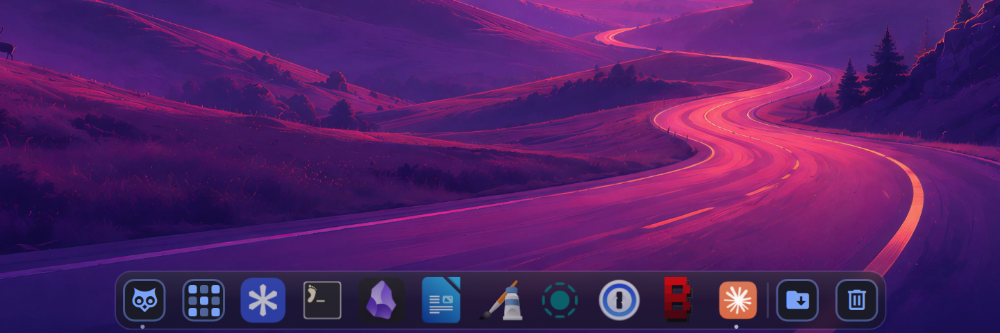
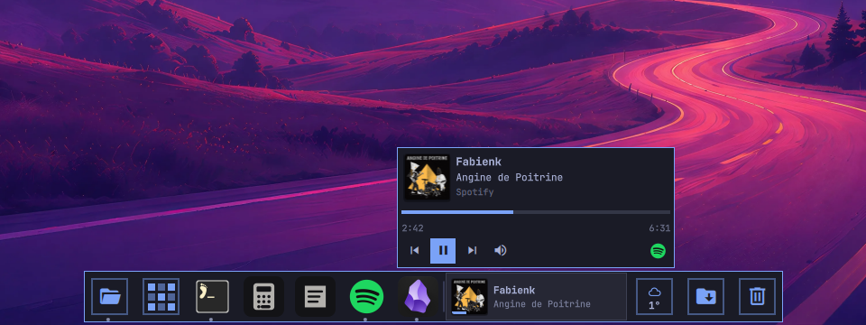
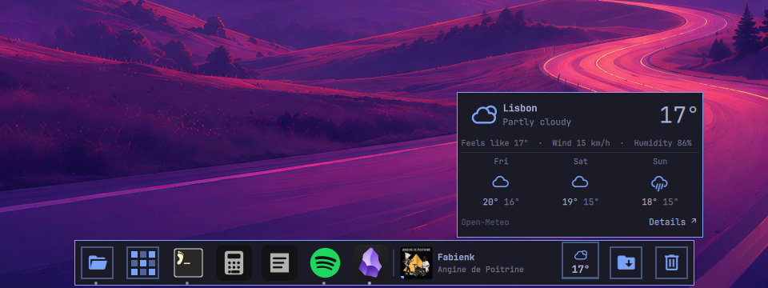
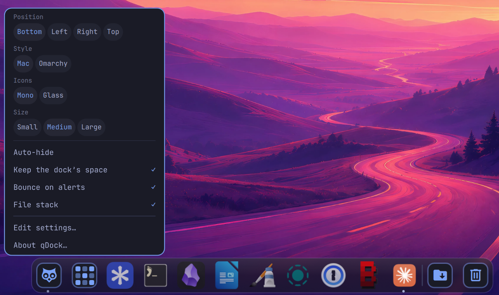
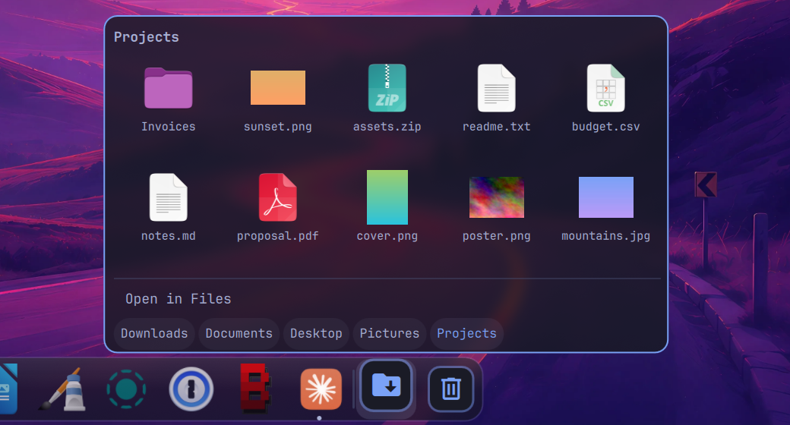
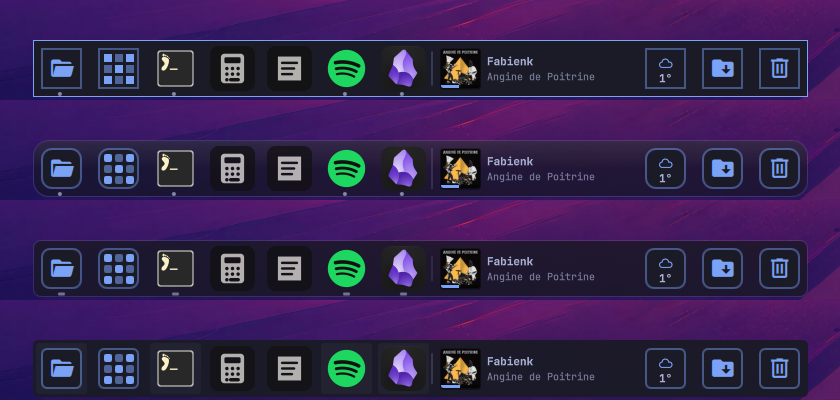
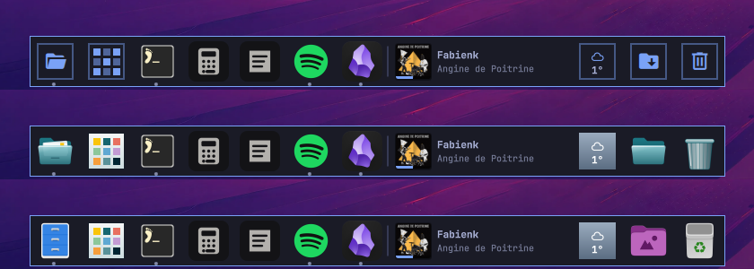
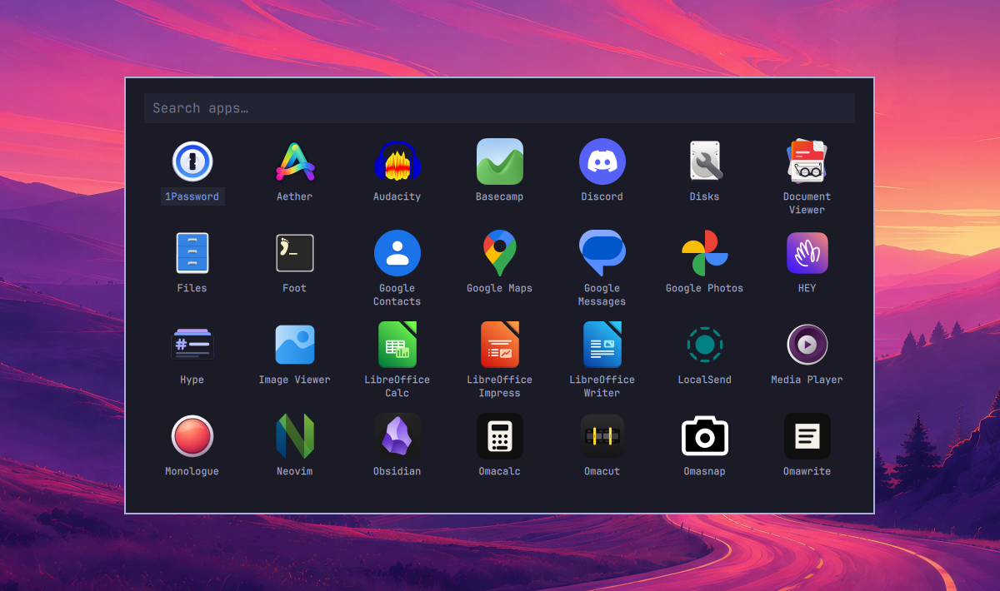
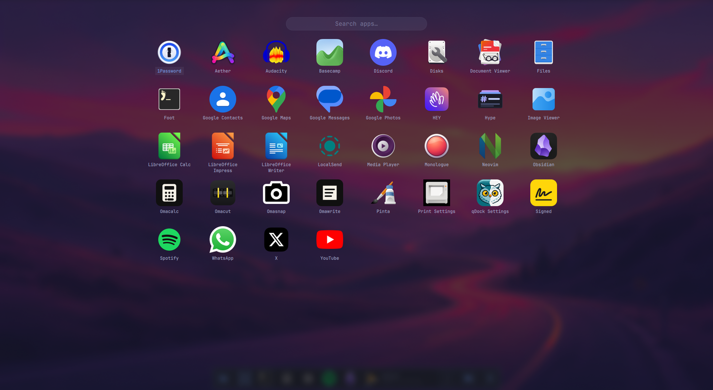
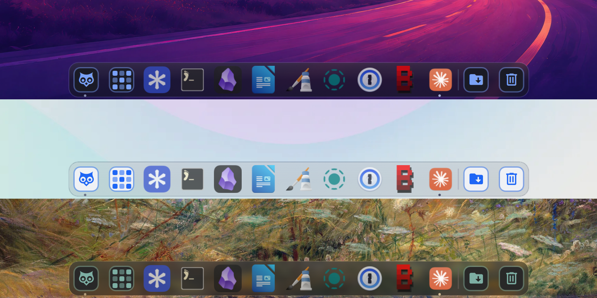

<p align="center">
  
</p>

<h1 align="center">qDock</h1>

<p align="center">A Mac-style dock for <a href="https://omarchy.org">Omarchy</a>, in your theme's colors.</p>

<p align="center"><a href="README.fr.md">Version française</a></p>



**Coming from macOS?** qDock is the Dock: Finder at its head, Launchpad, Stacks and the Trash.
Add [qExposé](https://github.com/quebecstudio-mods/omarchy-qexpose) for Exposé and Mission Control, and [qCenter](https://github.com/quebecstudio-mods/omarchy-qcenter) for the
Notification Center.

qDock replaces Omarchy's dock on floating workspaces. It keeps what the built-in
dock does (pinned apps, running windows, auto-hide, the app grid, its Launchpad) and adds:

- **Files, as an open folder**, where Finder sits on a Mac. A click opens your file manager; a right click lists
  your folders, your bookmarks and the trash.
- **Window lists.** Right-click an app to see its windows, bring one forward,
  open a new one, or quit.
- **A stack**, like the Mac's Downloads stack, of your newest downloads (or another folder), with files you can
  open, reveal, copy or drag into another app.
- **A trash**, at the end as on a Mac, that shows when it is full, takes files dropped on it, and can be
  emptied from its menu.
- **Now playing**, if you want: a tile with the cover, title and artist of the music playing (or
  paused) in any player (Spotify, mpv, a browser or a web app). Hover it for the progress and the controls.
- **The weather**, if you want: the sky and the temperature, and the next three days on hover. It
  comes in addition to the weather module of Omarchy's bar, not instead.
- **Badges, bounces and groups.** Apps asking for attention bounce, flash or light up;
  web apps can show an unread count; apps can be grouped by color.
- **Four styles.** Omarchy (opaque, with your theme's corners and borders),
  Cupertino (translucent and round, like the Mac's), Redmond (like the Windows
  taskbar) and Plasma (like KDE's task manager). Each brings its own running
  indicators, hover, badges, alerts and labels; alerts and labels can also be
  picked on their own.
- **Icons that fit.** Files, the stack, the trash and the weather in your theme's
  colors or in glass, and Files, the stack and the trash from your icon theme if
  you prefer; three sizes, and icons shrink when many apps are open.
- **A settings window**, drawn with Omarchy's own controls.
- **Keeps its space**, if you want: maximized windows stop at the dock.
- **English and French**, following Omarchy's language.

| Now playing | Weather |
| --- | --- |
|  |  |

| Settings window | Stack |
| --- | --- |
|  |  |

The four styles: Omarchy, Cupertino, Redmond and Plasma.



The three icon styles: Omarchy, glass and system.



| App grid, Omarchy | App grid, Cupertino |
| --- | --- |
|  |  |

It follows your theme as you switch: here with Tokyo Night, Catppuccin Latte and
Gruvbox.



## Install

```bash
omarchy plugin add https://github.com/quebecstudio-mods/omarchy-qdock --enable
```

Omarchy first shows a security notice and asks you to confirm (*Clone and add
this plugin?*); add `--yes` to skip the question in a script.

The dock shows on **floating** workspaces only, like Omarchy's. A fresh Omarchy
is tiled, so nothing appears until you make a workspace floating with
`omarchy hyprland workspace layout toggle`, or make it the default with
`omarchy hyprland workspace layout default floating`.

qDock takes the place of Omarchy's dock: enabling it turns the built-in one
off, and disabling it brings it back.

There is nothing to uninstall first. Another dock, though, would show next to
qDock: turn off any other Omarchy plugin that replaces the dock (`omarchy plugin
disable <id>`) and any standalone dock you started yourself, such as
`nwg-dock-hyprland`.

### Blur behind the translucent styles

The Cupertino, Redmond and Plasma styles are translucent (Cupertino the most).
For the blur behind them, and behind the full-screen app grid, add this rule to
`~/.config/hypr/hyprland.lua`:

```lua
hl.layer_rule({ match = { namespace = "^(omarchy-dock|omarchy-dock-apps)$" }, blur = true, ignore_alpha = 0.2 })
```

## Use

| | Click | Right click |
| --- | --- | --- |
| **Files** | Its windows, or your home folder | Folders, bookmarks, trash, new window |
| **Apps button** | Grid of every app | The dock's settings |
| **App** | Open it, or bring it forward | Its windows, new window, keep in or remove from the dock, quit |
| **Stack** | The folder's newest files | The same |
| **Trash** | Open it (or bring it back) | Empty the trash |
| **Now playing** | Play or pause | Keep the controls open |
| **Weather** | Keep the details open (with no place yet, pick one) | Its settings |

Drag apps to reorder them, or from the grid into the dock to pin them.
Middle-click an app to open a new window, the stack to open its folder, or the
music to bring its player forward.

The weather comes from [Open-Meteo](https://open-meteo.com), with no account
or key, every 15 minutes; while the tile is off, nothing is fetched. With no
place set in qDock or in Omarchy's weather panel, the tile asks you to pick one.
**Details** opens Omarchy's weather panel when it is in the bar and reports for
the same place, else a forecast page. A middle click fetches it again.

The music controls show on hover: previous, play or pause, next, mute and the
player. Mute silences the player, not the whole system (for a web app, its
whole browser). With several players open, the tile shows the one Omarchy's
media keys control, the one playing the longest, unless `musicPlayer` names
another.

## Settings

qDock has a settings window: right-click Files or the apps button and pick
**Dock Settings…**, or open **qDock Settings** from the app launcher. Appearance,
behavior, tiles and weather are there, and About.

To find it in Omarchy's menu too, under Appearance > Dock, add this line to
`~/.config/omarchy/extensions/omarchy-menu.jsonc`:

```jsonc
"appearance.dock.qdock": {"icon":"󰒓","label":"qDock Settings","aliases":["qdock"],"action":"omarchy-shell -q quebecstudio.qdock settings"},
```

The launcher entry is in the plugin's `assets` folder:

```bash
cp ~/.config/omarchy/plugins/qdock/assets/qdock-settings.desktop ~/.local/share/applications/
cp ~/.config/omarchy/plugins/qdock/assets/logo.png ~/.local/share/icons/hicolor/256x256/apps/qdock.png
```

Every setting is kept in qDock's entry under `plugins` in
`~/.config/omarchy/shell.json`, where the few the window leaves out (groups,
badges, the Files app) are set by hand (the **shell.json** link at the bottom of
the window opens it):

```json
{
  "id": "quebecstudio.qdock",
  "style": "cupertino",
  "iconSize": "large",
  "stackFolders": ["~/Pictures/Screenshots"],
  "groups": [{ "name": "work", "color": "#2dd4bf", "match": ["^chrome-.*-Profile_1$"] }]
}
```

| Setting | Values | Default |
| --- | --- | --- |
| `style` | `"omarchy"`, `"cupertino"` (`"mac"` in 1.0), `"redmond"`, `"plasma"` | `"omarchy"` |
| `launcher` | The app grid: `"omarchy"` (a card, like the Omarchy dock's), `"cupertino"` (full screen) | `"omarchy"` |
| `iconStyle` | `"omarchy"` (Files, stack, trash and weather drawn in your theme's accent; `"mono"` before 1.1), `"glass"` (qDock's own icons), `"system"` (your icon theme's, like the apps) | `"omarchy"` |
| `iconSize` | `"small"`, `"medium"`, `"large"`, or pixels (24 to 96) | `"medium"` |
| `attention` | How an app asking for attention shows it: `"auto"` (as the style does), `"bounce"` (then a halo), `"flash"` (orange, then held), `"highlight"` (a framed accent square) | `"auto"` |
| `labels` | The name shown over a hovered app: `"auto"` (as the style does), `"theme"` (your theme's tooltip), `"pill"`, `"box"` (small and plain) | `"auto"` |
| `bounce` | Alerts move (bounce or flash) before their mark holds | `true` |
| `reserveSpace` | Maximized windows stop at the dock | `false` |
| `stack` | Show the stack | `true` |
| `stackCount` | Files in the stack, 5 to 30 | `15` |
| `stackFolders` | Folders offered besides Downloads, Documents, Desktop and Pictures | `[]` |
| `music` | Now playing: `"hidden"`, `"mini"` (the cover alone), `"normal"`, `"large"` (wider, for long titles); the cover alone on a side dock | `"hidden"` |
| `musicPlayer` | The player to show first, by part of its name, any case (`"spotify"`) | `""` |
| `weather` | Show the weather tile | `false` |
| `weatherLocation` | `{ "name", "latitude", "longitude", "country" }` (the country code sets the unit in `"auto"`), picked in the settings by searching for a city; left out, the place of Omarchy's weather panel | — |
| `weatherUnit` | `"auto"` (the unit of Omarchy's weather module, else by the place's country), `"metric"`, `"imperial"` | `"auto"` |
| `filesApp` | Desktop id of your file manager | `"org.gnome.Nautilus"` |
| `filesIcon` | `"omarchy"`, `"glass"`, `"system"`, or an image path (absolute or starting with `~/`) | `iconStyle` |
| `groups` | Color groups, in order: `name`, `color`, and `match`, regexes on the desktop id (the window class for an app without one) | `[]` |
| `badges` | Unread counts for web apps (see below) | — |

Position, auto-hide and pinned apps stay in Omarchy's own `dock` settings,
set with `omarchy dock`.

### Badges

A badge shows a number read from a JSON file on an app's icon, and follows the
file as it changes. Each entry gives the apps (`match`, regexes on the desktop
id, or the window class for an app without one), the file, and the `path` to the number: one `/` per level,
and a `key=value` segment picks an element of an array.

```json
"badges": [{ "match": ["^Mail$"], "file": "~/.local/state/mail.json", "path": "accounts/name=work/unread" }]
```

## Works with qExposé

[qExposé](https://github.com/quebecstudio-mods/omarchy-qexpose) adds a Mac-style
Exposé and an Alt+Tab switcher with previews. When it is enabled, an app's menu
in the dock offers **Show All Windows**: every window of that app, across
workspaces, minimized ones included.

## Commands

qDock has its own commands:

```bash
omarchy-shell -q quebecstudio.qdock apps              # toggle the app grid
omarchy-shell -q quebecstudio.qdock stack             # toggle the stack on the focused screen
omarchy-shell -q quebecstudio.qdock menu              # toggle the apps button's menu on the focused screen
omarchy-shell -q quebecstudio.qdock stackOn DP-1      # the same, on a named screen
omarchy-shell -q quebecstudio.qdock menuOn DP-1
omarchy-shell -q quebecstudio.qdock settings          # toggle the settings window
omarchy-shell -q quebecstudio.qdock about             # the settings window, on About
omarchy-shell -q quebecstudio.qdock settingsAt tiles  # on a section: appearance, behavior, tiles, weather, about
omarchy-shell -q quebecstudio.qdock weather           # toggle the weather's details (weatherOn DP-1 on a named screen)
```

It also answers to Omarchy's own dock commands (`omarchy-shell -q omarchy.dock apps`,
`refresh`), which Omarchy sends itself, and to those of qDock 1.0.

## See also

- [qCenter](https://github.com/quebecstudio-mods/omarchy-qcenter), a notification center with today's agenda.
- [qExposé](https://github.com/quebecstudio-mods/omarchy-qexpose), Exposé and Alt+Tab with previews.
- [Changelog](CHANGELOG.md): what changed in each version.

## License

MIT © Québec Studio

macOS, Finder, Launchpad, Mission Control and Exposé are trademarks of Apple Inc.; Windows is a trademark of Microsoft Corporation; KDE and Plasma are trademarks of KDE e.V. This project is not affiliated with or endorsed by any of them.
